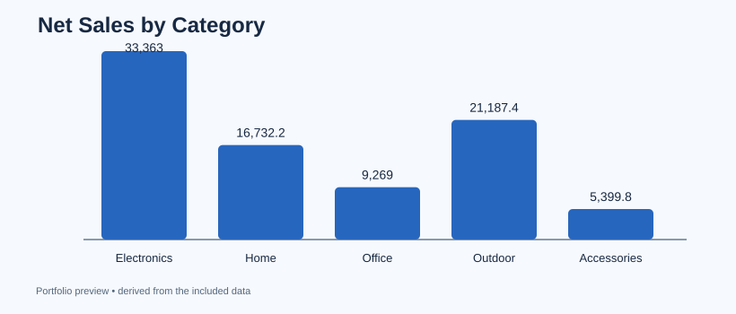

# 01 — Retail Sales & Profit Analysis

**Business question:** Which product categories contribute the most net sales and gross profit?

**Tools:** Python, pandas, SQLite (SQL), CSV, matplotlib. **Data:** 480 fictional order rows committed in data.csv. No real customer or commercial records.

## What I built
- Validated unique order IDs and discount ranges.
- Handled missing regions explicitly as "Unknown" (instead of losing orders).
- Calculated net sales and gross profit **excluding returned orders**.
- Compared categories in pandas; ran an independent aggregated SQL query.
- Exported a KPI table, SQL results, a JSON summary, and a PNG chart.

## Run
From this directory after installing ../requirements.txt:

~~~bash
python analyze.py
~~~

Outputs: outputs/kpis.csv, outputs/sql_results.csv, outputs/summary.json, outputs/chart.png. See [sample findings](findings.md) and [SQL query](queries.sql).

**Metrics:** net sales = quantity × unit price × (1 − discount) for non-returns. Gross profit subtracts item cost for non-returns. Margin = gross profit / net sales. Shipping, tax, payroll, and overhead are excluded.

## Interview talking point
"I cleaned a retail sales table, defined consistent return-aware KPIs, and reconciled category performance using pandas and a SQLite query." A next step would be ingesting multiple years of actual transactions and measuring seasonality.
