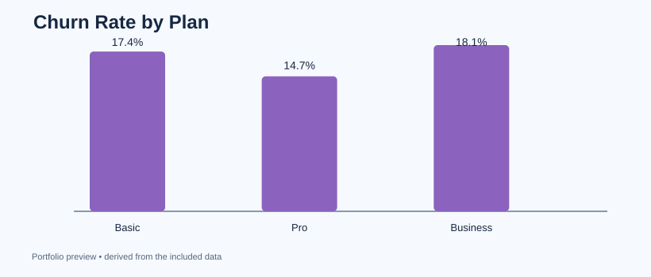

# 02 — Subscription Customer Churn Analysis

**Business question:** What customer segments have higher observed churn rates?

**Tools:** pandas, Python, SQL (SQLite), aggregation, segmentation, data visualization.

**Data:** 360 synthetic customer rows. Each row is one customer; churned is a binary *snapshot label*. This is not a real cohort study or a churn prediction model.

## What I built
- Checked unique customer IDs and binary churn labels.
- Compared churn by subscription plan and support-ticket activity.
- Calculated the sum of monthly fees linked to churned accounts, **not** a forecast of lost revenue.
- Created a segment report in pandas and a SQL aggregation for cross-checking.
- Exported tables and a bar chart.

## Run
~~~bash
python analyze.py
~~~

Outputs go to outputs/. See [findings](findings.md) and [SQL](queries.sql).

## Interview talking point
"I used customer-level data to define churn rate with the correct denominator, compare segment behavior, and explain why observational differences are not causal." For real data, define a cohort window, exposure period, and recurring-revenue metric first.
