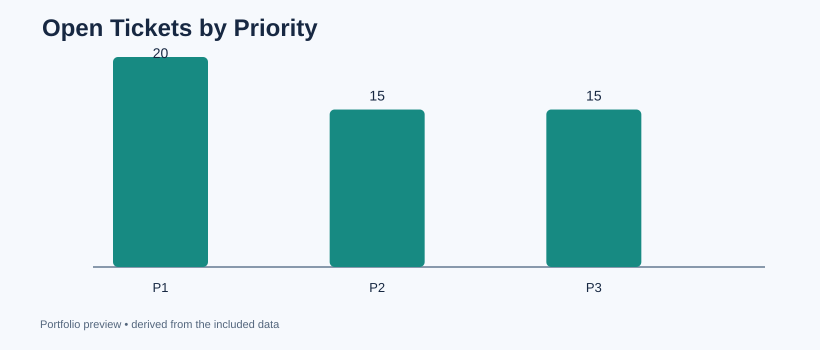

# 03 — IT Help Desk SLA Analytics

**Operations question:** How large is the support backlog, and which priority levels miss response-resolution targets?

**Tools:** Python/pandas, SQL, missing-value handling, SLA KPI definitions, charts.

**Data:** 420 simulated help-desk tickets. No internal service desk records or real users.

## What I built
- Defined P1/P2/P3 resolution SLAs (4 / 24 / 72 hours, for demonstration only).
- Calculated SLA attainment **only among resolved tickets**.
- Counted unresolved cases separately, preventing an incorrect 0-hour resolution assumption.
- Calculated median resolution duration and CSAT response coverage.
- Created SQL and pandas reports with an actionable priority-level backlog view.

## Run
~~~bash
python analyze.py
~~~

Outputs go to outputs/. See [example findings](findings.md) and [the SQL report](queries.sql).

## Interview talking point
"I measured open-ticket backlog and resolution SLAs without mixing open and completed tickets in the denominator." For an operational dashboard, I would add ticket age, daily queue snapshots, and escalation ownership.
