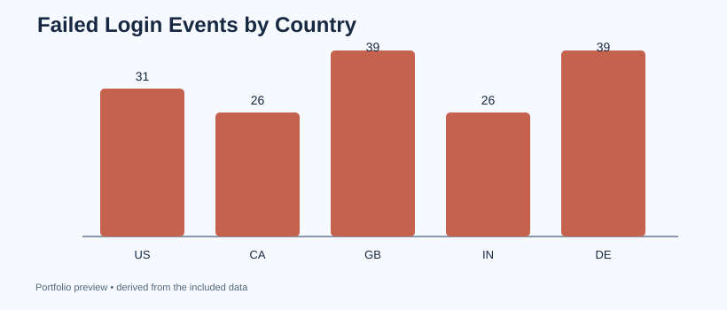

# 04 — Login Security Event Analytics

**Security analytics question:** Which user-day combinations contain unusually many failed login events?

**Tools:** pandas, SQL, time grouping, event counts, rule-based security monitoring.

**Data:** 744 simulated sign-ins; all usernames are invented and IP ranges are reserved documentation networks (RFC 5737). **Not real security incidents.**

## What I built
- Parsed timestamps and standardized success/failure events.
- Counted failed login events by day, user, and country.
- Applied a transparent rule: flag a user/day with **8 or more** failures.
- Reported rule hits and overall failure rates with equivalent SQL.
- Created a chart for comparative monitoring.

## Run
~~~bash
python analyze.py
~~~

Outputs go to outputs/. See [findings](findings.md) and [SQL alert logic](queries.sql).

## Safety and interpretation
This is a triage exercise, **not** an intrusion detection product. Failed logins may have legitimate explanations. The country field is an invented log attribute, not evidence of threat origin. Production use needs baselines, time zones, exclusions, deduplication, validation and analyst review.

## Interview talking point
"I translated raw login events into measurable security KPIs and documented why a threshold-based anomaly flag requires human verification."
