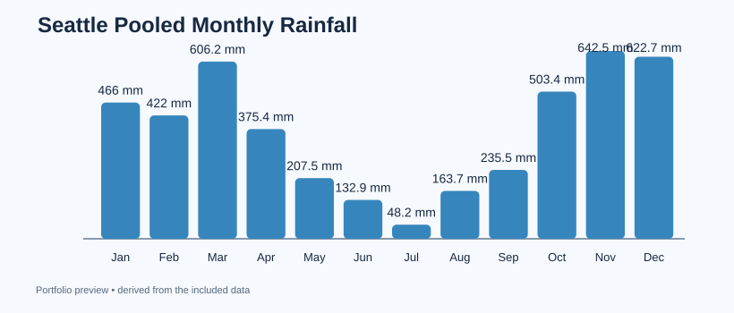

# 05 — Seattle Historical Weather Trends

**Research question:** How do daily temperatures and precipitation vary across months in Seattle?

**Tools:** pandas, SQLite SQL, time-series groupings, QA checks, charts.

## Real data and provenance
This file contains **real historical observations** (2012–2015) from [Vega Datasets: seattle-weather.csv](https://github.com/vega/vega-datasets/blob/main/data/seattle-weather.csv), transformed from records attributed to the **NOAA National Climatic Data Center**. [Metadata / license note](https://github.com/vega/vega-datasets/blob/main/datapackage.md#seattle-weathercsv): the dataset lists "U.S. Government Dataset"; the categorical weather field is synthesized for teaching. Attribution remains with the original data providers. Not live measurements or a weather forecast.

## What I built
- Verified dates, nonnegative precipitation, and unique daily records.
- Converted dates into month groups, measured average daily highs, and counted precipitation-positive days.
- Made an independently executable SQLite monthly aggregation.
- Exported a monthly KPI table, summary JSON and a PNG time-series chart.
- Explained the difference between **pooled four-year monthly totals** and annual averages.

## Run
~~~bash
python analyze.py
~~~

Outputs go to outputs/. See [historical findings](findings.md) and [SQL query](queries.sql).

## Interview talking point
"I cleaned and validated public time-series data, grouped observations by calendar month, and used Python and SQL to report seasonal patterns with clear unit and time-window definitions."
